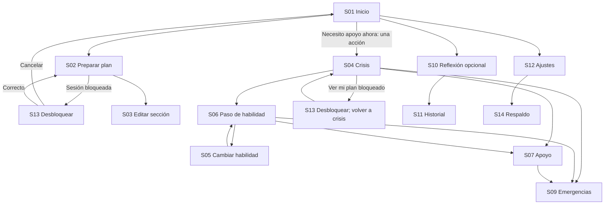

# 05 · Arquitectura de información y navegación

Fecha: 2026-10-15. La preparación y la crisis comparten datos y separan prioridades: preparación permite editar; crisis muestra instrucciones breves y acciones de apoyo. No hay chat, feed, puntuaciones ni recomendaciones por IA.

## Mapa y acceso

| Área | Pantallas | Acceso |
|---|---|---|
| Inicio | S01 | Público; resumen personal solo desbloqueado |
| Preparación | S02 plan, S03 editor | Personal; S13 si está bloqueado |
| Crisis | S04 guía inicial | Público; fragmentos del plan solo desbloqueado |
| Habilidades | S05 catálogo, S06 guía | Contenido público; personalización protegida |
| Apoyo | S07 contactos, S08 editor | Personal; S13 si está bloqueado |
| Emergencias | S09 | Público; selección manual país/región, sin geolocalización |
| Reflexión | S10 registro, S11 historial/detalle | Personal |
| Privacidad y dispositivo | S12 ajustes, S14 respaldo | Público para preferencias; datos requieren sesión |
| Acceso personal | S13 desbloqueo/creación | Frase secreta; no cuenta |
| Bienvenida | S15 | Pública y omisible; nunca antes de crisis |

Navegación principal de preparación: Inicio, Mi plan, Habilidades y Apoyo, con texto e icono. Reflexión y ajustes tienen enlaces claros desde inicio; no más de cuatro destinos en la barra inferior. Crisis usa encabezado compacto, «Salir de la guía», «Buscar apoyo», «Emergencias» y «Cambiar habilidad»; elimina la barra de preparación. Salir de la guía vuelve al inicio, no borra rastros ni cierra el navegador.

## Diagrama de recorridos

## Estructura del plan

1. Reconocer: emociones frecuentes, señales tempranas y sensaciones corporales.
2. Comprender contexto: vulnerabilidades previas y acontecimientos desencadenantes, separados; pensamientos e impulsos no se confunden con acciones.
3. Elegir apoyo propio: estrategias que ayudan, estrategias que empeoran, habilidades preferidas, personalización y orden de crisis.
4. Conectar: contactos personales, profesional tratante, alternativas y mensaje preparado.
5. Preparar emergencias: país/región manual y selección entre recursos oficialmente verificados. Un número personal introducido por el usuario permanece como contacto personal sin sello de verificación.

El orden de crisis es editable durante preparación: primer paso, una estrategia breve y contacto preferido. Por defecto empieza STOP y conserva alternativas públicas. No obliga a revisar todos los elementos del plan durante crisis; «Ver más de mi plan» es divulgación opcional.

## Contratos de navegación y estado

- Rutas descriptivas pueden usar `/`, `/plan`, `/crisis`, `/skills`, `/skills/:publicSkillId`, `/support`, `/emergency`, `/reflection`, `/history`, `/settings`, `/unlock`, `/backup`, `/welcome`. IDs y texto de registros personales nunca aparecen en query, fragmento, título de pestaña o URL; detalle personal seleccionado en memoria. Refresco vuelve a lista bloqueada, nunca a datos descifrados.
- Título de pestaña y pantalla del selector del SO son neutrales («Refugio»); esto reduce exposición y no garantiza privacidad del historial ni capturas.
- Un guardián de sesión protege lectura y escritura; volver atrás no restaura una pantalla personal desbloqueada desde caché de navegación. La clave vive solo en memoria: cierre, recarga y bloqueo manual la eliminan. Autobloqueo tras 5 minutos de inactividad o 5 minutos oculta; al volver se comprueba el plazo antes de mostrar datos. Se advierte 30 segundos antes cuando la pantalla está visible y se permite continuar. Al ocultarse se sustituye el contenido privado por una vista neutra como mitigación, sin descartar aún la clave hasta el plazo. La vista de aplicaciones recientes puede conservar información; no se promete ocultarla.
- Al recuperar foco desde marcador/compositor externo, la sesión puede haberse bloqueado al superar el plazo; crisis pública mantiene su contexto no sensible. Nunca repite automáticamente una acción externa.
- Atrás vuelve al origen lógico. Descartar borrador requiere confirmar únicamente cuando existen cambios no guardados; entrar en crisis siempre conserva prioridad y permite apartar un borrador sin confirmar.
- Una pantalla tiene un encabezado principal. Navegación mueve foco al encabezado; «Volver» devuelve foco a la acción origen si existe. Un diálogo devuelve foco al disparador.
- Estados transversales: cargando local (esqueleto sin datos personales), vacío, listo, bloqueado, guardando, guardado, error de persistencia, sin conexión y contenido pendiente de verificación. No se usa un spinner como único diagnóstico.
- No hay actualizaciones forzadas ni recargas durante crisis o edición. Actualización disponible se ofrece en ajustes tras cerrar trabajo.

## Invariantes verificables

UX-01: S01→S04 necesita una activación sin acceso previo a datos personales. UX-02: desde S04 y S06 hay acción persistente para apoyo y emergencias. UX-03: plan parcial nunca bloquea ayuda pública. UX-04: no hay preguntas obligatorias en crisis. UX-05: modo offline no oculta recursos ya descargados. UX-06: todo destino personal bloqueado conserva retorno a crisis. UX-07: no existe promesa de salida rápida, borrado del navegador o llamada atendida. UX-08: ningún recurso de emergencia sin verificación se convierte en enlace de llamada.
