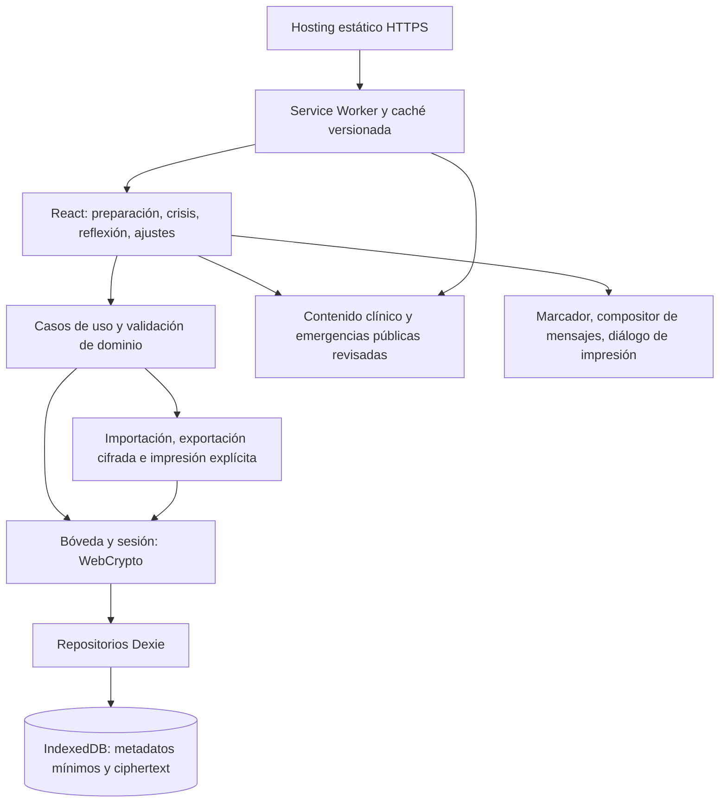

# 08. Arquitectura técnica

Estado: especificación propuesta para implementación, 2026-10-15. Decisiones [ADR-001](adr/0001-local-first-pwa.md) y [ADR-002](adr/0002-local-security.md). Evidencia consultada y límites en [research/architecture-evidence.md](research/architecture-evidence.md). No existe aplicación implementada ni compatibilidad certificada.

## Alternativas y decisión

| Alternativa | Ventajas | Costes y efecto en crisis | Decisión |
|---|---|---|---|
| React + TypeScript + Vite, SPA PWA estática, IndexedDB/Dexie | Una base web, descarga inicial pequeña, todas las funciones locales, hosting simple | El navegador puede borrar datos; instalación y exportación varían por plataforma | Elegida para MVP; mitigar pérdida con copia cifrada y plan impreso |
| Next.js con renderizado servidor y cuentas | Sincronización entre dispositivos y recuperación mediante cuenta | Backend, sesiones y red añaden fallos y tratamiento de datos sensibles; SSR no aporta al plan privado | Descartada en MVP; reevaluar si sincronización pasa a requisito |
| Aplicación nativa multiplataforma | Integración con almacenes de claves del SO y distribución en tiendas | Dos canales de distribución y mayor coste operativo; sigue necesitando estrategia de recuperación | Posible evolución si la retención PWA no cumple las pruebas |

El MVP se aloja como recursos estáticos bajo un origen HTTPS exclusivo y estable. No necesita API de negocio, cuenta, servidor de datos, IA, analítica, publicidad, push ni sincronización. TypeScript en modo estricto, React y Vite para UI y empaquetado; Dexie encapsula IndexedDB; Workbox integra precache y ciclo de actualizaciones bajo control de la aplicación. Fijar versiones exactas y lockfile en implementación, después de verificar soporte y vulnerabilidades; estas especificaciones no inventan versiones validadas.

## Componentes y fronteras

La UI no consulta IndexedDB ni usa WebCrypto directamente. Los casos de uso dependen de interfaces `PlanRepository`, `ReflectionRepository`, `SupportRepository`, `VaultSession`, `BackupService`, `PublicContentRepository` y `PlatformCapabilities`. El adaptador de persistencia no interpreta instrucciones clínicas. El contenido público versionado se distribuye con la aplicación; los datos personales jamás se incluyen en caché HTTP, SW, URLs o logs. Las dependencias de dominio no importan React, Dexie ni Workbox.

Módulos de entrega: `app` (rutas, accesibilidad, estado efímero), `features/plan`, `features/crisis`, `features/skills`, `features/reflections`, `features/support`, `features/settings`, `domain`, `storage`, `security`, `content`, `platform`. Son límites propuestos, no archivos de producción creados en esta fase. Código y contenido clínico requieren revisión independiente antes de publicar cambios.

## Flujos críticos

1. Arranque: mostrar shell público → detectar capacidades → abrir almacén → determinar existencia de bóveda → ofrecer crisis genérica o desbloqueo. Nunca esperar red para abrir crisis después de preparación offline verificada.
2. Desbloqueo: derivar clave en memoria, autenticar y descifrar el envelope completo; exponer a la UI solo los datos necesarios; error de contraseña/corrupción no borra registros. No existe recuperación de frase olvidada.
3. Guardado: validar → cifrar → transacción local → confirmar «Guardado en este dispositivo». La UI nunca informa éxito antes del commit. Una escritura fallida conserva cambios en memoria mientras la sesión siga abierta y ofrece reintento; no asegura persistencia tras cerrar.
4. Crisis: tomar instantánea coherente del plan desbloqueado y mantenerla en memoria durante la sesión. Sin cuestionarios, peticiones remotas ni migraciones pendientes que bloqueen el contenido público. Un plan vacío muestra recorrido genérico y acceso a emergencias, sin inventar contactos personales.
5. Exportación: copia completa cifrada con la frase actual de la bóveda, sesión desbloqueada y acción explícita; el plan imprimible es una segunda acción, desbloqueada y consciente, que genera contenido legible. Ninguna exportación se envía a un servidor.

## Offline y caché

El precache integral incluye shell, CSS, JavaScript requerido por crisis y las seis habilidades, iconos y tipografías locales, textos clínicos y directorio público de emergencias con sus ámbitos y fechas. No depender de CDN, fuentes remotas ni lazy chunks ausentes para el recorrido crítico. Los recursos de emergencia se muestran solo conforme a verificación y cobertura en el protocolo de seguridad; la caché no convierte un número pendiente en verificado. Un recurso previamente verificado cuya revisión haya vencido conserva acceso con advertencia, fecha y región; candidatos nunca verificados y recursos retirados no ofrecen acción de contacto. El vencimiento offline no elimina el último acceso conocido a ayuda.

Mostrar «Disponible sin conexión» únicamente después de instalación y activación del SW y comprobación de que todos los recursos del manifiesto crítico están en caché. Esta comprobación indica el estado actual, no garantiza retención futura. Primera visita sin red, almacenamiento rechazado, caché incompleta o datos desalojados deben tener mensajes diferenciados. Un sitio nunca visitado no puede abrirse offline. Solicitar `navigator.storage.persist()` desde preparación tras explicar su utilidad; denegación no impide uso, y no se promete detectar modo privado. Una instalación en pantalla de inicio tampoco constituye una copia de seguridad.

Navegaciones sirven shell local con fallback adecuado; recursos de cada build usan hashes y caché inmutable. El SW no abre ni migra la bóveda, no recibe claves y no intercepta esquemas `tel:` o `sms:`. «Sin conexión» describe acceso al contenido: llamadas y mensajes requieren capacidades y red del dispositivo, y nunca se confirma que un contacto recibió ayuda.

## Actualizaciones y consistencia entre pestañas

Una versión nueva se descarga a caché separada y queda `waiting`; no se ejecuta `skipWaiting()` ni recarga automática. Dentro de crisis no se muestra un diálogo intrusivo de actualización. Fuera de crisis, «Actualizar ahora» guarda cambios, bloquea bóveda y requiere que todas las pestañas activas hayan salido de crisis antes de activar y recargar. Coordinar por BroadcastChannel con fallback de mensajes de `clients`; si no se puede confirmar el estado de todas las pestañas, diferir hasta cierre natural. Una pestaña suspendida o sin respuesta nunca se interpreta como autorización.

Conservar caché de la versión activa hasta que ningún cliente la use; un SW no debe eliminar recursos que la UI anterior todavía necesita. Una descarga parcial no sustituye el shell válido. Las revisiones clínicas urgentes se publican como nuevas versiones revisadas; offline no existe garantía de recepción inmediata. El equipo necesita procedimiento de comunicación externa antes de retirar contenido peligroso; no puede prometer revocación remota instantánea.

## Persistencia, migración y recuperación

IndexedDB almacena una instantánea completa de la bóveda cifrada, revisión de almacenamiento y metadatos mínimos; no indexa emociones, contactos ni texto. Consultas de dominio se resuelven en memoria tras descifrar la instantánea; el volumen acotado del MVP admite esta limitación. Cada edición reemplaza atómicamente el envelope completo con control de revisión; el modelo físico normativo está en 09. El contrato de entidades, límites y backup se especifica en [09](09-data-model.md) y [11](11-security-and-privacy.md).

Separar versión de esquema IndexedDB, versión del payload de dominio, versión de contenido público y versión del formato de backup. Migraciones estructurales no descifran datos y son transaccionales. Migración del payload ocurre después de desbloqueo: leer → validar → transformar en memoria → cifrar instantánea completa con IV nuevo → guardar en transacción; conservar originales hasta commit. Migración fallida mantiene fuente y permite exportar backup cifrado o reintentar; no eliminar ni recrear automáticamente la base.

No iniciar migraciones de payload durante una crisis ya activa. Un formato incompatible no bloquea habilidades y emergencias genéricas. `versionchange` solicita cerrar conexiones de otra pestaña fuera de crisis; si una crisis está activa, se posterga actualización. No forzar cierre de la pestaña. Recuperar por importación validada y confirmada, inicialmente sin fusión entre planes; rechazar versiones futuras sin modificar datos. Un downgrade no debe abrir una bóveda más nueva con lectura/escritura incompatible.

## Sesión y disponibilidad

Clave solo en RAM, nunca en localStorage, IndexedDB, caché, URL ni SW. Recarga/cierre requiere desbloquear de nuevo. Bloqueo explícito inmediato; automático tras cinco minutos sin interacción o al regresar de un segundo plano de cinco minutos o más. Avisar 30 segundos antes del bloqueo por inactividad cuando la página sea visible, sin tapar el acceso público a emergencias; permitir prolongar mediante interacción explícita. Medir tiempos transcurridos al recuperar foco, antes de renderizar datos; no depender de timers en segundo plano. Interacción en crisis reinicia inactividad; timers de habilidades, audio o eventos de red no cuentan como interacción. Al bloquear retirar DOM sensible y referencias a clave/datos; el navegador no permite prometer borrado físico de memoria ni ocultar todas las capturas del selector de aplicaciones.

Este coste de acceso protege un dispositivo compartido, pero puede dificultar consultar el plan durante una crisis. Mitigación explícita: crisis genérica y emergencias públicas accesibles bloqueado, desbloqueo opcional para plan/contactos, preparación y copia impresa previa. No usar «acceso inmediato al plan» para una sesión bloqueada ni incluir información personal en una pantalla pública de emergencia.

## Plataformas y restricciones

| Entorno | Objetivo de soporte | Condición y alternativa |
|---|---|---|
| iOS/iPadOS 17+ Safari y modo instalado | Preparación, desbloqueo, seis habilidades y crisis offline | Verificación física obligatoria de instalación, reabrir, suspensión, SW, almacenamiento y exportación; instrucciones manuales de instalación, sin depender de `beforeinstallprompt` |
| Android 12+ con Chrome, últimas dos versiones estables | Mismo alcance | Probar navegador y modo instalado en dispositivo físico; instalación sugerida solo si la capacidad existe |
| Escritorio, últimas dos versiones estables de Chrome/Edge/Firefox/Safari | Preparación, impresión y consulta | Verificar diferencias de impresión/descarga; no es la plataforma principal |
| Navegador embebido, privado o sin WebCrypto/IndexedDB/SW | Ayuda pública cuando sea técnicamente posible | No ofrecer guardado seguro degradado a texto plano; explicar limitación y abrir navegador compatible |

No utilizar Background Sync, tareas programadas, biometría o notificaciones como dependencias. No forzar instalación. La matriz es una promesa de pruebas antes de lanzamiento, no evidencia de compatibilidad actual. Cambiar mínimos exige ADR y pruebas de migración.

## Rendimiento, mantenimiento y límites de crecimiento

Los presupuestos de peso, arranque y respuesta tienen una única fuente normativa en [13](13-non-functional-requirements.md), y condiciones de prueba en [14](14-testing-strategy.md). Evitar imágenes decorativas remotas; la derivación criptográfica se mide aparte y debe mostrar progreso accesible. Si un presupuesto se incumple, corregir o registrar excepción antes de publicación; no declarar métricas medidas aquí.

Sin adjuntos multimedia ni historial ilimitado de versiones. Validar límites de registros y tamaño antes de descifrar/importar; no descargar todo el mundo ni almacenar directorios clínicos remotos. Escala de usuarios afecta hosting estático, no una base central; escala local se valida con fixtures máximos. Sincronización futura requerirá nuevo ADR, modelo de amenazas, consentimiento, conflictos y borrado remoto: no reservar endpoints ficticios.

## Criterios arquitectónicos de aceptación

- ARC-01: después de readiness y desconexión/reapertura, shell, seis habilidades y crisis pública funcionan; plan personal tras desbloqueo sin red.
- ARC-02: red capturada durante edición/crisis no contiene datos personales; no existen llamadas a una API de negocio.
- ARC-03: actualización instalada durante crisis no cambia UI, contenido ni DB; pestaña suspendida bloquea activación forzada.
- ARC-04: fallos de cuota, transacción, migración y backup corrupto conservan datos previos y muestran salida pública de crisis.
- ARC-05: con bóveda bloqueada no aparecen texto privado, contactos ni claves en almacenamiento sin cifrar, DOM o caché; no se promete resistencia a malware/XSS.
- ARC-06: pérdida de IndexedDB comunica ausencia de datos y ofrece importación sin crear un plan ficticio.
- ARC-07: las plataformas objetivo pasan pruebas físicas registradas antes del lanzamiento; un informe de escritorio no cumple este criterio.
