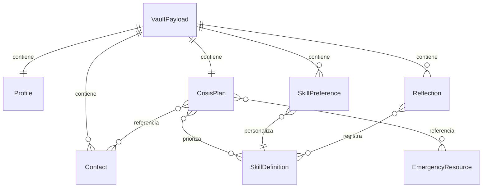

# 09 · Modelo de datos

Fecha: 2026-10-15. Estado: especificación para implementación; no existe base de datos implementada. Relacionado: [arquitectura](08-technical-architecture.md), [contratos](10-api-contracts.md), [privacidad](11-security-and-privacy.md).

## Decisiones y clasificación

**DATA-01 · P0.** Una instalación tiene una bóveda personal local, sin cuenta, identificador de usuario remoto ni sincronización. Dexie gestiona IndexedDB. Se cifra una instantánea completa de la bóveda antes de persistirla; nunca se indexan textos, teléfonos, emociones o fechas clínicas en claro. Adecuado al pequeño volumen del MVP; revisar rendimiento antes de ampliar límites.

**DATA-02 · P0.** Contenido editorial de habilidades y catálogo oficial de recursos son públicos y versionados en el paquete PWA. Personalizaciones, selección regional, plan, contactos y reflexiones pertenecen a la bóveda. No se mezclan registros personales con cachés del service worker.

| Entidad lógica | Campos principales | Reglas |
|---|---|---|
| `VaultPayload` | `schemaVersion`, `vaultId`, `revision`, `createdAt`, `updatedAt`, `profile`, `plan`, `contacts[]`, `skillPreferences[]`, `reflections[]` | `vaultId` UUID aleatorio local; fechas ISO-8601 UTC; revisión entera creciente. Sin nombre real obligatorio, correo, documento ni fecha de nacimiento. |
| `Profile` | `locale: es-CO`, `country: CO`, `regionCode?`, `adultConfirmedAt`, `privacyNoticeVersion`, `sensitiveDataAcknowledgedAt` | Autodeclaración 18+, no verificación de identidad. La constancia local no se presenta como prueba jurídica suficiente. |
| `CrisisPlan` | `id`, `version`, `frequentEmotions[]`, `earlySignals[]`, `vulnerabilities[]`, `triggers[]`, `thoughts[]`, `bodySensations[]`, `impulses[]`, `helpfulStrategies[]`, `unhelpfulStrategies[]`, `prioritySkillIds[]`, `priorityContactIds[]`, `professionalContactIds[]`, `personalEmergencyContactIds[]`, `emergencyResourceIds[]`, `safetySteps[]`, `updatedAt` | Un plan activo; campos opcionales para guardar borrador. safetySteps es lista de PlanItem con máximo tres pasos iniciales; prioritySkillIds conserva orden manual y referencia las seis habilidades. Vulnerabilidad = condición previa; desencadenante = acontecimiento. Recursos oficiales solo referencias verificadas; recursos personales se guardan como Contact y se referencian mediante personalEmergencyContactIds, con etiqueta «Añadido por ti, sin verificación oficial». |
| `PlanItem` | `id`, `text`, `order` | Texto libre, no taxonomía diagnóstica. ID estable para editar/reordenar. |
| `Contact` | `id`, `displayName`, `role: personal\|professional`, `channels[]`, `availabilityText?`, `supportMessage?`, `alternateContactId?`, `order`, `updatedAt` | No importar agenda del dispositivo. No acceso automático a contactos. Relación alternativa sin autoenlace; eliminación limpia referencias en una transacción. |
| `ContactChannel` | `type: tel\|sms`, `value` | MVP solo teléfono/SMS, normalización explícita a formato internacional cuando se conoce país. Sin URL libre ejecutable. No inferir que un contacto garantiza disponibilidad. |
| `SkillPreference` | `skillId`, `personalSteps[]`, `helpfulExamples[]`, `avoidNotes?`, `prosConsCard?`, `updatedAt` | `skillId` pertenece a los seis IDs editoriales. Advertencias clínicas editoriales nunca pueden borrarse con una personalización. prosConsCard solo para pros-contras: impulsePros, impulseCons, alternativePros, alternativeCons y summary, todos opcionales de texto breve; no puntúa ni decide automáticamente. |
| `Reflection` | `id`, `occurredAt?`, `situation?`, `vulnerabilities[]`, `trigger?`, `emotions[]`, `thoughts[]`, `bodySensations[]`, `impulses[]`, `skillIds[]`, `intensityBefore?`, `intensityAfter?`, `outcome?`, `learning?`, `createdAt`, `updatedAt` | Registro voluntario posterior a crisis. Intensidades enteras 0–10 o ausentes; no se calcula diagnóstico ni éxito obligatorio. |
| `SkillDefinition` público | `id`, `contentVersion`, `title`, `goal`, `whenToUse`, `precautions[]`, `shortSteps[]`, `examples[]`, `reviewStatus`, `sourceRefs[]` | IDs estables: `stop`, `pros-contras`, `tip`, `aceptas`, `cinco-sentidos`, `salvara`. Publicación requiere revisión clínica del contenido. |
| `EmergencyResource` público | `id`, `country`, `regionCodes[]`, `coverageText`, `serviceName`, `phone`, `availabilityText`, `officialSourceUrl`, `verifiedAt`, `reviewDueAt`, `verificationStatus`, `reviewerRole` | Solo `verified` puede ofrecer llamada. A los 90 días sin nueva revisión conserva acceso con aviso «Puede haber cambiado», fecha y cobertura; `retired` y `pending` no ofrecen llamada. Una cobertura no se amplía por asumir prefijo nacional. Candidatos 123/106 permanecen deshabilitados hasta verificación oficial. |

No hay historial de cada apertura del modo crisis, rastreo de estado emocional, geolocalización, biometría, datos de dispositivos o almacenamiento automático de mensajes enviados. La app no registra si se completó una llamada/SMS: el sistema operativo no proporciona una confirmación fiable uniforme.



Las relaciones son lógicas dentro del documento cifrado, no tablas consultables sin desbloquear. No se duplica texto privado en una tabla pública.

## Persistencia física

IndexedDB `refugio`, versión de esquema independiente de la versión del payload:

| Almacén | Clave / contenido en claro | Finalidad |
|---|---|---|
| `vault` | Clave fija `primary`; `envelope` cifrado y `storageRevision` entero | Único dato personal persistente, protegido por AES-GCM. `storageRevision` para comparación atómica, sin índice clínico. |
| `preferences` | Claves acotadas: `theme`, `textSize`, `reducedMotionOverride`, `installHelpDismissed` | Preferencias no sensibles. País/región y confirmación de mayoría de edad se guardan dentro de la bóveda. |

El catálogo público y los recursos editoriales viven como archivos estáticos versionados en caché de la PWA, no como datos recibidos de un servidor de usuario. El envelope revela tamaño aproximado y parámetros criptográficos; el cifrado no oculta la existencia de la app ni de una bóveda.

**DATA-03 · P0.** Crear/editar en memoria → validar → serializar JSON UTF-8 canónico → cifrar con nonce nuevo fuera de la transacción → transacción Dexie `readwrite`: comparar `storageRevision` esperado, escribir envelope y aumentar revisión. Un conflicto entre pestañas devuelve `CONFLICT`; nunca sobrescribe silenciosamente. Al bloquearse otra pestaña invalida su sesión mediante `BroadcastChannel`; verificar estado/revisión al recuperar foco porque el canal puede perder mensajes. Sin mecanismo fiable de coordinación, la segunda pestaña se abre solo para contenido público.

## Envelope y copias

Formato lógico del archivo `.refugio` y del registro local:

```json
{
  "format": "refugio-vault",
  "formatVersion": 1,
  "kdf": {"name": "PBKDF2", "hash": "SHA-256", "iterations": 600000, "salt": "base64url(16 bytes)"},
  "cipher": {"name": "AES-GCM", "keyBits": 256, "iv": "base64url(12 bytes)", "tagBits": 128},
  "ciphertext": "base64url(ciphertext con tag)"
}
```

Es una ilustración de contrato, no un archivo importable. La cabecera sin `ciphertext`, serializada de forma canónica definida por el formato v1, es AAD autenticada. Derivación y validación: [11](11-security-and-privacy.md). El payload contiene sus propias versiones/fechas; no se exportan en claro. Un backup exporta el envelope completo vigente y no incluye preferencias públicas. La exportación no solicita una segunda frase ni recifra el archivo: se abre con la frase que tenía la bóveda al descargarlo. Nombre predeterminado `refugio-copia.refugio`, sin nombre personal ni fecha de crisis.

## Límites y validación

**DATA-04 · P0.** El mismo esquema de validación se aplica a formularios, comandos locales, importaciones y migraciones. No confiar en tipos TypeScript para archivos externos.

- Bóveda descifrada ≤2 MiB de UTF-8; archivo externo ≤8 MiB antes de leerlo completo; rechazar profundidad JSON >12 y propiedades desconocidas. Medir después de descifrar antes de parsear objetos completos cuando sea técnicamente viable; el límite cifrado también limita memoria.
- Máximo 50 elementos por lista del plan, 100 contactos, 200 reflexiones, 20 pasos personales por habilidad. No eliminar automáticamente al alcanzar límite: ofrecer borrar/exportar y conservar lo anterior.
- Texto breve ≤500 caracteres Unicode; reflexiones `situation`, `outcome`, `learning` ≤4.000 cada uno; nombres ≤100; mensaje de apoyo ≤1.000; teléfono ≤32. Mantener Unicode y saltos de línea permitidos; representar siempre como texto, nunca HTML.
- UUID válidos y únicos; referencias internas existentes; orden sin duplicados tras normalizar; enums cerrados; fechas válidas, sin imponer diagnóstico por antigüedad; enteros finitos. Referencias a recursos públicos retirados se marcan no disponibles, sin sustituir por otro número.
- Importar formato desconocido o esquema posterior devuelve `UNSUPPORTED_VERSION`. Los archivos no se abren como HTML ni se ejecutan, aunque su extensión sea `.refugio`.

## Evolución, borrado e importación

**DATA-05 · P0.** Migración secuencial y pura `vN → vN+1`, solo tras autenticar y validar; no modificar la bóveda anterior hasta validar y cifrar la nueva. Fallo conserva envelope anterior. Solicitar copia antes de una migración irreversible; una app antigua rehúsa escribir un esquema más reciente. La actualización del service worker espera una sesión segura, sin forzar recarga en crisis.

**DATA-06 · P0.** Importación MVP es **reemplazo completo**, sin fusión. Archivo → límites y cabecera → frase de la copia → autenticación → validación/migración en memoria → vista de recuentos sin textos privados → confirmación explícita de reemplazo y opción de descargar copia actual → cifrado con clave/frase de la bóveda destino y sal nueva → transacción atómica con control de revisión. En instalación nueva, la persona confirma una frase para la bóveda importada. Cancelación, cuota o fallo conservan la bóveda anterior. La frase de la copia puede ser distinta de la frase actual. En reemplazo existente se pide de nuevo la frase actual del destino y se autentica antes de derivar con sal nueva; no basta una frase arbitraria introducida en este paso. La revisión de almacenamiento aumenta desde el destino, sin adoptar una revisión externa como autoridad. Borrar datos de la aplicación requiere confirmación; los backups descargados no se pueden borrar desde la app.

## Criterios de aceptación

| ID | Evidencia requerida |
|---|---|
| AC-DATA-01 | Buscar un texto y un teléfono canarios en IndexedDB, localStorage, CacheStorage, URLs y logs no encuentra valores en claro tras guardar/bloquear. |
| AC-DATA-02 | Dos escrituras con igual revisión generan un éxito y un conflicto, conservando un documento íntegro. |
| AC-DATA-03 | Copia alterada, sobredimensionada, versión futura, referencia rota o cuota agotada no modifica datos actuales. |
| AC-DATA-04 | Migración interrumpida permite volver a abrir el envelope anterior con su frase original. |
| AC-DATA-05 | Las seis habilidades públicas abren bloqueado; personalizaciones, región privada y contactos no se exponen. |
