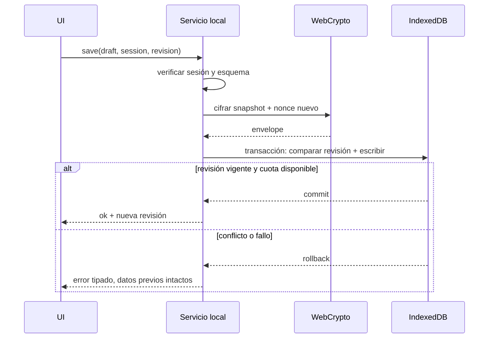

# 10 · Contratos de servicios locales

Fecha: 2026-10-15. MVP sin backend, endpoints HTTP, cuentas, autenticación remota, telemetría ni IA. Este documento especifica interfaces internas para que UI, dominio y adaptadores sean implementables y verificables; no crea servidores ni código de producción.

## Convenciones

**API-01 · P0.** Los comandos asíncronos devuelven `Promise<Result<T, LocalError>>`. La UI nunca recibe una excepción con texto privado. `Result` distingue `ok: true, value` de `ok: false, error: {code, retryable}`. Mensajes públicos se resuelven desde un catálogo español, sin interpolar contenido sensible. Toda escritura requiere sesión desbloqueada, revisión esperada y validación del modelo [09](09-data-model.md).

`SessionHandle` es referencia opaca efímera a una clave WebCrypto no extraíble mantenida en memoria; no se serializa. No es JWT, contraseña, identidad ni token de red. Se invalida al bloquear, recargar o cerrar la app. `Revision` es entero monótono. La generación de UUID y fechas corresponde al dominio local. Los ejemplos de firmas son contratos documentales.

| Servicio / operación | Entrada | Salida / efecto |
|---|---|---|
| `Vault.status()` | Ninguna | `absent`, `locked`, `unlocked`, `unavailable` o `incompatible`; no devuelve recuentos privados bloqueado. |
| `Vault.create(secret, confirmations)` | Frase ≥16 caracteres NFC, mayoría de edad y aviso de datos sensibles | Crea bóveda vacía cifrada de forma atómica; devuelve sesión/revisión. Nunca persiste `secret`. Si existe bóveda, falla `ALREADY_EXISTS`. |
| `Vault.unlock(secret)` | Frase | Deriva clave y autentica envelope; devuelve sesión/revisión. No revela si falló por frase incorrecta o contenido manipulado. |
| `Vault.lock()` | Ninguna | Invalida sesión, vacía estado privado y coordina bloqueo entre pestañas. Idempotente. |
| `Vault.changeSecret(session, oldSecret, newSecret, expectedRevision)` | Frase actual y nueva confirmada | Autentica, genera sal/nonce nuevos y reemplaza envelope atómicamente. Copias anteriores conservan su frase anterior. |
| `Plan.read(session)` | Sesión | Plan completo y revisión en memoria. No retorna datos si sesión vencida. |
| `Plan.save(session, draft, expectedRevision)` | Plan validado | Persiste incluso incompleto; devuelve revisión y `preparedSections` informativos, nunca una puntuación clínica. |
| `Contacts.upsert/remove(session, contactOrId, expectedRevision)` | Contacto o ID | Guarda o elimina, limpiando referencias del plan y alternativos atómicamente. No llama ni envía mensajes. |
| `Skills.listPublic(contentVersion?)` | Versión opcional | Seis habilidades y precauciones editoriales; funciona bloqueado/offline con paquete instalado. |
| `Skills.savePreference(session, preference, expectedRevision)` | Personalización | Guarda sin permitir alterar precauciones públicas. |
| `Reflections.list/get/save/remove(session, input, expectedRevision?)` | Filtro acotado, ID o registro | Paginación local ≤20 por página. Solo las escrituras exigen revisión. Ningún análisis diagnóstico automático. |
| `EmergencyCatalog.list(country, regionCode?)` | Selección pública manual, sin GPS | Solo recursos previamente verificados no retirados, cobertura y fecha visibles; si pasaron 90 días, conserva acceso con «Puede haber cambiado». Entrada bloqueada efímera: no lee región privada. Puede devolver lista vacía con alternativa de ayuda presencial. |
| `Backup.exportEncrypted(session)` | Sesión | `Blob` con envelope vigente, MIME `application/octet-stream`, extensión `.refugio`; no se sube. |
| `Backup.inspect(file, backupSecret)` | Archivo y frase de copia | Validación completa en memoria; devuelve token efímero de preparación y recuentos, sin escritura. Token expira al bloquear o a los 5 min. |
| `Backup.replace(sessionOrNewSetup, token, destinationSecret, expectedRevision, confirmation)` | Token validado, frase destino, confirmación | Revalida estado/revisión y la frase actual de destino, y reemplaza todo atómicamente con sal nueva. Sin fusión. En instalación nueva requiere confirmaciones del alta. |
| `Plan.preparePrint(session, selectedSections, sensitiveAcknowledgement)` | Selección explícita y aviso | Vista efímera para impresión del plan; excluye reflexiones y notas no seleccionadas. `window.print` solo por acción de la persona. |
| `Vault.deleteAll(confirmation)` | Confirmación explícita | Elimina registros locales privados, preferencias y clave en memoria; conserva paquete público offline. Puede realizarse bloqueado si no se recuerda frase; no conserva copia implícita. Avisa que backups externos permanecen. |

`Backup.exportEncrypted` exige desbloqueo para que terceros con el dispositivo bloqueado no extraigan fácilmente una copia desde la UI; esto no evita que quien controle el navegador copie físicamente la base de datos. No hay exportación JSON en claro en MVP. La impresión puede generar PDF mediante el diálogo del sistema, fuera del control de la app.

## Acciones del dispositivo

**API-02 · P0.** `ContactActions.prepare(session, contactId, channel)` devuelve un destino `tel:`/`sms:` validado y texto breve para revisión. `ContactActions.open` solo se invoca después de una pulsación explícita. No se dispara en efectos de renderizado, restauración de pestaña o importación. Sanitizar teléfonos; construir esquemas permitidos sin aceptar URLs de archivo. El sistema puede pedir confirmación y necesita servicio telefónico; offline web no equivale a conectividad de llamadas. Cancelar conserva el flujo. No marcar contacto como avisado ni mensaje como enviado.

**Mejoras detectadas, no requisito de disponibilidad:** copiar número/mensaje solo tras pulsación; si portapapeles se rechaza, texto seleccionable. Web Share puede abrir el panel nativo tras vista previa explícita y selección de destinatario en el sistema; comprobar `navigator.canShare`/`navigator.share`, sin enviar automáticamente ni interpretar cierre exitoso como entrega. No compartir la bóveda completa mediante este flujo. Disponibilidad del contacto es texto opcional escrito por la persona, nunca presencia en tiempo real.

Recursos oficiales se resuelven exclusivamente por `resourceId` del catálogo habilitado; un archivo importado no puede crear un recurso oficial ni cambiar su número. Los contactos personales personalizados se identifican claramente como tales. No hay integración WhatsApp, lectura de agenda, envío automático, alertas a terceros ni botón que afirme haber llamado sin evidencia.

## Errores estables

| Código | Tratamiento de UI |
|---|---|
| `LOCKED`, `SESSION_EXPIRED` | Vaciar UI privada antes de renderizar; ofrecer desbloquear y ayuda genérica. |
| `UNLOCK_FAILED` | “No pudimos abrir esta copia. Revisa la frase o utiliza otra copia.” Mismo mensaje para autenticación fallida/corrupción. |
| `INVALID_INPUT`, `INVALID_FILE`, `FILE_TOO_LARGE`, `LIMIT_REACHED` | Indicar campo o límite sin mostrar contenido del archivo. Conservar borrador mientras sesión siga válida. |
| `UNSUPPORTED_VERSION` | Mantener datos y explicar necesidad de versión compatible; no convertir destructivamente. |
| `CONFLICT` | No guardar; ofrecer recargar datos vigentes y volver a aplicar cambios tras revisión. |
| `STORAGE_UNAVAILABLE`, `QUOTA_EXCEEDED` | No afirmar guardado; conservar borrador en memoria, ofrecer copia cifrada cuando sea posible. |
| `CRYPTO_UNAVAILABLE` | Impedir crear/guardar bóveda; mantener habilidades y ayuda genérica. HTTPS/WebCrypto son requisitos. |
| `CATALOG_UNAVAILABLE`, `NO_VERIFIED_RESOURCE` | Sin números candidatos; explicar ausencia y mostrar ayuda presencial/genérica. |
| `ALREADY_EXISTS`, `CANCELLED` | No modificar la bóveda; cancelación sin mensaje de fallo alarmante. |

El resultado de “guardado” solo se anuncia tras completar la transacción IndexedDB. Un fallo de impresión o de descarga no cambia el plan. No se promete que el archivo haya quedado en disco: el diálogo del navegador puede cancelarse.

## Futuro, deliberadamente diferido

Sin contrato remoto en MVP. Una fase futura de sincronización requerirá ADR y consentimiento separados, modelo de amenazas, jurisdicción/proveedor, autenticación, claves entre dispositivos, borrado remoto, conflictos, revocación y recuperación. Evaluar cifrado de extremo a extremo antes de seleccionar proveedor. No reservar dominios, tablas de servidor, rutas HTTP ni credenciales en anticipación. Una cuenta por sí sola no recuperaría una clave que el servidor no conoce.

## Criterios de aceptación

- **AC-API-01:** ninguna operación de dominio usa `fetch`, SDK de analytics o endpoint remoto; la red solo sirve paquete público/actualizaciones de la PWA. Enlaces externos se abren por acción explícita.
- **AC-API-02:** invocar cualquier método privado con sesión vencida devuelve error y no expone datos; cancelar importación conserva revisión y envelope previos.
- **AC-API-03:** un fallo de cuota no produce anuncio “Guardado”; una carrera entre pestañas no pierde la escritura ganadora.
- **AC-API-04:** exportación e impresión requieren acción explícita; no se envían contactos/mensajes automáticamente; el catálogo vacío no habilita 123/106.
