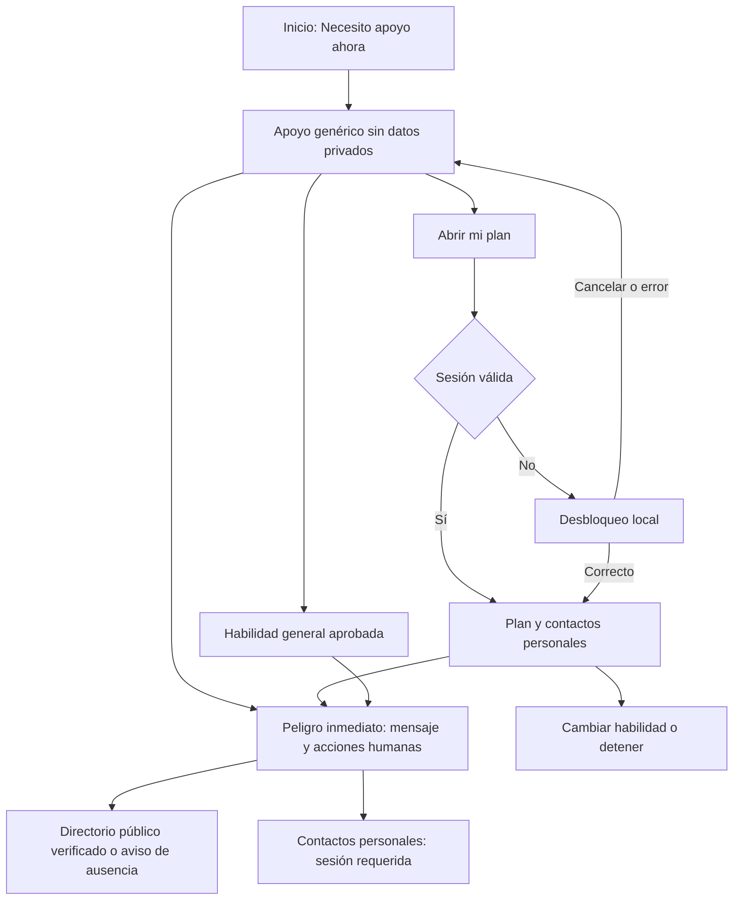

# 12 · Seguridad clínica y protocolos de crisis

Fecha: 2026-10-15. Estado: diseño pendiente de revisión clínica acreditada y verificación territorial de recursos. Prioridad P0 salvo indicación contraria. Relación: RF-002, RF-003, RF-005, RF-006, RF-007 y RF-008. Este protocolo no acredita a Refugio como dispositivo médico ni como servicio de respuesta.

## Política invariable

El MVP no evalúa ni predice peligro, no detecta crisis a partir de texto, intensidad o uso, no clasifica riesgo, no incluye IA generativa y no inicia llamadas, mensajes o alertas por sí mismo. La persona elige la acción y confirma el uso del sistema operativo para llamar o abrir un medio de contacto. No hay monitoreo profesional, chat atendido, despacho ni garantía de respuesta.

Ningún recurso de emergencia sin verificación oficial se publica como número accionable. La ausencia de permiso de ubicación o conexión no bloquea ayuda genérica. No se pide geolocalización automática; país y región se eligen en preparación o en el directorio genérico.

## Acceso y límites de confidencialidad

La pantalla inicial ofrece «Necesito apoyo ahora». Abre directamente un modo genérico disponible sin desbloquear: instrucciones breves, habilidades generales aprobadas y recursos públicos verificados cuando existan. No muestra datos del plan, nombres, mensajes guardados, preferencias, historial ni contactos personales mientras el almacén esté bloqueado.

«Abrir mi plan» solicita el desbloqueo local solo cuando no existe sesión válida. Una sesión ya desbloqueada abre el plan directamente. No hay bypass por modo crisis. Si la persona no puede desbloquear, permanece el apoyo genérico y no se insiste con recuperación. Los contactos personales permanecen visibles dentro del modo crisis únicamente después de desbloquear; puede usarse un encabezado «Apoyo» sin datos en estado bloqueado. Esta decisión concilia disponibilidad con el riesgo de dispositivos compartidos.

La instrucción inicial de bloqueo dice: «Puedes usar apoyo general sin abrir tus datos. Para ver tu plan y contactos, desbloquea Refugio». No se ofrece biometría en el MVP; el desbloqueo usa la frase secreta de la bóveda. La exportación de respaldo, importación y ajuste de credenciales nunca interrumpen el acceso genérico.

## Peligro inmediato: acceso voluntario

Siempre existe el enlace «Hay peligro inmediato»; no depende de un cuestionario. No exigir confirmar intención, puntuaciones, consentimiento analítico ni haber practicado una habilidad. No detectar ni inferir que la persona está en peligro a partir de su escritura.

Texto base para revisión clínica y de accesibilidad:

> Si tú u otra persona están en peligro inmediato, busca ayuda humana ahora. Si puedes hacerlo sin aumentar el peligro, ve a un lugar más seguro y pide a una persona de confianza que te acompañe. Contacta los servicios de emergencia de tu zona o acude a un servicio de urgencias si puedes hacerlo de forma segura. Refugio no avisa a nadie por ti.

Acciones: «Ver emergencias de mi región» (directorio público), «Ver mis contactos» (requiere sesión), «Volver». Si existe un número verificado y aplicable, mostrar servicio, número, cobertura y «Llamar» sin prometer disponibilidad. No sugerir conducir ni enfrentarse a otra persona; no detallar manejo de armas, sustancias o medios de daño. Si no hay recursos verificados, decir «No tenemos una línea verificada para esta región. Busca los servicios de emergencia locales o pide ayuda presencial». Esta ausencia debe ser visible y nunca reemplazarse por un número supuesto.

Las prácticas guiadas no son paso previo a pedir ayuda. Dolor torácico, dificultad respiratoria importante o pérdida de conciencia no reciben recomendación de respiración o TIP como tratamiento. La aplicación ofrece el acceso a ayuda humana sin hacer diagnóstico.

## Flujo de estados

Toda pantalla de crisis contiene salida, cambio de habilidad y acceso a apoyo; el botón de llamada necesita una elección explícita. No hay carrousel automático ni bloqueo por temporizador. El modo crisis evita edición y reflexión por defecto. Tras cerrarlo, «Registrar después» es opcional y se puede ignorar sin confirmaciones repetidas.

## Estados clínicos y operativos

| Estado | Comportamiento especificado | Prohibición |
|---|---|---|
| Plan vacío | Mostrar apoyo genérico y «Puedes preparar tu plan más tarde» | Forzar onboarding o inventar contactos |
| Plan parcial | Mostrar solo información disponible, más alternativas genéricas | Completar campos por inferencia |
| Bloqueo o clave olvidada | Mantener ayuda genérica y directorio público; explicar que datos privados requieren clave | Revelar contactos o sugerir que soporte recupera claves |
| Sin conexión, shell ya disponible | Plan descifrable local y contenido aprobado en caché; indicar «Sin conexión» sin diálogo bloqueante | Prometer que llamadas/mensajes funcionan |
| Primera visita sin red / caché eliminada | El navegador puede no cargar nada; documentar límite y fomentar respaldo al preparar | Afirmar disponibilidad offline universal |
| Llamada no iniciada | Mostrar número verificado copiable y alternativa humana; no asumir conexión | Declarar «contacto avisado» |
| Contacto no responde | Permitir elegir siguiente contacto o emergencias verificadas | Reintentar o enviar mensajes automáticamente |
| Habilidad incomoda | «Detén esta práctica. Puedes elegir otra opción o pedir compañía» | Obligar a terminar o repetir |
| Datos dañados o migración fallida | Conservar copia cifrada recuperable; abrir ayuda genérica | Mostrar texto parcial privado o borrar silenciosamente |
| Directorio ausente/obsoleto | Sin datos, ayuda genérica; recurso antes verificado vencido conserva acceso con fecha, región y aviso «Puede haber cambiado» | Activar candidato nunca verificado o recurso retirado |

Un enlace telefónico abre el marcador; una llamada puede necesitar cobertura celular aunque la app esté offline. La web no puede garantizar red, saldo, funcionamiento del sistema ni respuesta del servicio. Un enlace a mensajería tampoco demuestra que el mensaje se envió. Mostrar «Abrir llamada»/«Abrir mensaje», no «Ayuda en camino».

## Colombia: candidatos sin habilitar

La investigación de esta entrega no ha logrado recuperar y revisar evidencia oficial suficiente sobre líneas 123 y 106 y sus coberturas. Los intentos y restricciones de acceso se documentan en investigación. No se concluye que estos servicios no existan; se concluye que esta entrega no puede activar sus datos con evidencia comprobada. No se extrapola cobertura de una ciudad a toda Colombia.

| ID editorial | Número candidato | Pregunta de verificación | Estado de producto |
|---|---|---|---|
| CO-123-CANDIDATE | 123 | Autoridad competente, tipo de emergencia, cobertura territorial y acceso vigentes | Deshabilitado, excluido del catálogo distribuido |
| CO-106-CANDIDATE | 106 | Servicio, ciudades/departamentos concretos, horario, canales, requisitos y alcance | Deshabilitado, excluido del catálogo distribuido |

Estos candidatos existen solo en documentación editorial; no son enlaces `tel:`, recursos activos ni contactos precargados. No se hacen llamadas de prueba a emergencias. La persona puede guardar un contacto de su elección, etiquetado «Guardado por ti; no verificado por Refugio»; nunca se eleva automáticamente a recurso oficial ni evita revisión editorial.

## Gate EMERG-01: activación de un recurso

Antes de distribuir una entrada deben existir: fuente oficial de la entidad responsable o autoridad pública competente; URL exacta; fecha de consulta y fecha de vigencia si se informa; nombre del servicio; país, región y localidades cubiertas; número y canal; horario/zona horaria; audiencia/restricciones conocidas; texto que avala cobertura; responsable de revisión y estado de aprobación. No inferir «24/7», gratuidad, atención psicológica, acceso nacional o multilingüe si no se documenta. La ausencia de un dato esencial impide activación; datos no esenciales desconocidos se muestran como no informados.

Un segundo revisor editorial comprueba que número, servicio y jurisdicción coinciden con la evidencia. La revisión profesional clínica comprueba que la descripción no promete una intervención inexistente. La activación se registra por versión del catálogo. Fuentes secundarias pueden orientar búsqueda, pero no satisfacen el gate. Esta aprobación editorial no equivale a validación médica de la app.

Cada entrada tiene `verifiedAt`, `reviewDueAt` (máximo 90 días desde revisión), `officialSourceUrl`, `country`, `regionCodes`, `coverageText`, `verificationStatus` y versión. Antes del lanzamiento y de cada release se revisan recursos que vayan a distribuirse. Al superar `reviewDueAt` sin nueva verificación se conserva el acceso al recurso previamente verificado, incluida su acción manual de llamada, con aviso visible «Puede haber cambiado», fecha y región. El vencimiento por sí solo no elimina la única ayuda disponible offline. Si el reloj es incoherente no se proclama actualidad: mostrar «No podemos confirmar la vigencia» y conservar la última información verificada con ese aviso. Candidatos nunca verificados y recursos con retirada confirmada no ofrecen llamada. Conservar información histórica no garantiza que el servicio siga disponible, que la llamada conecte ni que exista atención o monitoreo por Refugio.

En MVP sin backend, los cambios se distribuyen en una actualización del catálogo estático firmado por el proceso de build. Una instalación offline puede conservar una versión antigua: se muestra fecha de revisión; no se promete revocación remota. Se excluyen de la caché los candidatos. La política de vencimiento debe probarse con fechas y en offline. La app sigue ofreciendo ayuda genérica cuando no hay una entrada utilizable. Una retirada confirmada inhabilita el recurso en el siguiente catálogo recibido; una instalación offline puede seguir mostrando información histórica hasta actualizarse. Este límite se comunica sin afirmar revocación inmediata.

## Registro de riesgos

| ID | Daño o fallo | Mitigación y propietario |
|---|---|---|
| R-CL01 | Retrasar ayuda confiando en una práctica | Acceso permanente a peligro inmediato; sin habilidad obligatoria. Producto/clínico |
| R-CL02 | Práctica corporal perjudicial | TIP conservadora, CLIN-02 y opción sin foco corporal. Clínico |
| R-CL03 | Número equivocado, cambiado o cobertura supuesta | EMERG-01, catálogo versionado, revisión cada 90 días y advertencia de desactualización; retirados deshabilitados. Editorial |
| R-CL04 | Exposición de contactos en dispositivo compartido | Plan cifrado, sesión requerida, ayuda genérica bloqueada. Seguridad |
| R-CL05 | Pérdida de disponibilidad por caché/clave | Preparación y respaldo exportable, mensaje honesto, fallback genérico. Arquitectura |
| R-CL06 | Confundir registro con evaluación clínica | Sin detección, puntuación de riesgo, diagnóstico ni seguimiento atendido. Producto |
| R-CL07 | Mensaje o llamada no completados | Acción manual, etiquetas de apertura y alternativas. Frontend |
| R-CL08 | Distracción agrava peligro o recuerdos | Detener/cambiar siempre; sin prácticas impuestas; revisión de microcopy. Clínico/UX |

## Criterios de aceptación y evidencia

- SAFE-01: desde inicio se llega a apoyo genérico con una activación y sin campos obligatorios, con sesión cerrada, plan vacío y modo avión si existe caché.
- SAFE-02: con sesión cerrada, lectores de pantalla, DOM, vistas previas y navegación atrás no exponen contactos, plan ni registros; la vista de ayuda sigue disponible.
- SAFE-03: «Peligro inmediato» se abre sin cuestionario y muestra acciones humanas sin prometer respuesta o envío automático.
- SAFE-04: buscar candidatos 123/106 en el catálogo distribuido no devuelve recursos activos mientras EMERG-01 esté pendiente; el test valida estado, no que las cifras estén prohibidas en documentación.
- SAFE-05: una entrada sin fuente, cobertura o aprobación no supera validación del catálogo; una entrada antes verificada vencida conserva llamada manual con aviso «Puede haber cambiado», fecha y región, también offline; candidatos y retirados no ofrecen llamada.
- SAFE-06: abrir una habilidad y salir no crea reflexión ni implica uso exitoso; la intensidad nunca activa comunicaciones ni cambia un nivel de riesgo.
- SAFE-07: auditar el catálogo confirma ausencia de hielo/inmersión, ejercicio intenso y retención como instrucciones activas.
- SAFE-08: simular marcador/mensajería no disponibles permite volver y elegir otra acción; ninguna pantalla afirma que alguien fue notificado.
- SAFE-09: revisión clínica acreditada del contenido exacto y registro editorial de recursos son condiciones de publicación pública; el prototipo documental puede revisarse con ambos gates abiertos.

La estrategia de pruebas deberá vincular estos IDs a [14](14-testing-strategy.md). La responsabilidad clínica y editorial debe asignarse en [15](15-mvp-roadmap.md) antes de desarrollar contenido para publicación. No hay validación clínica externa realizada en esta entrega.
